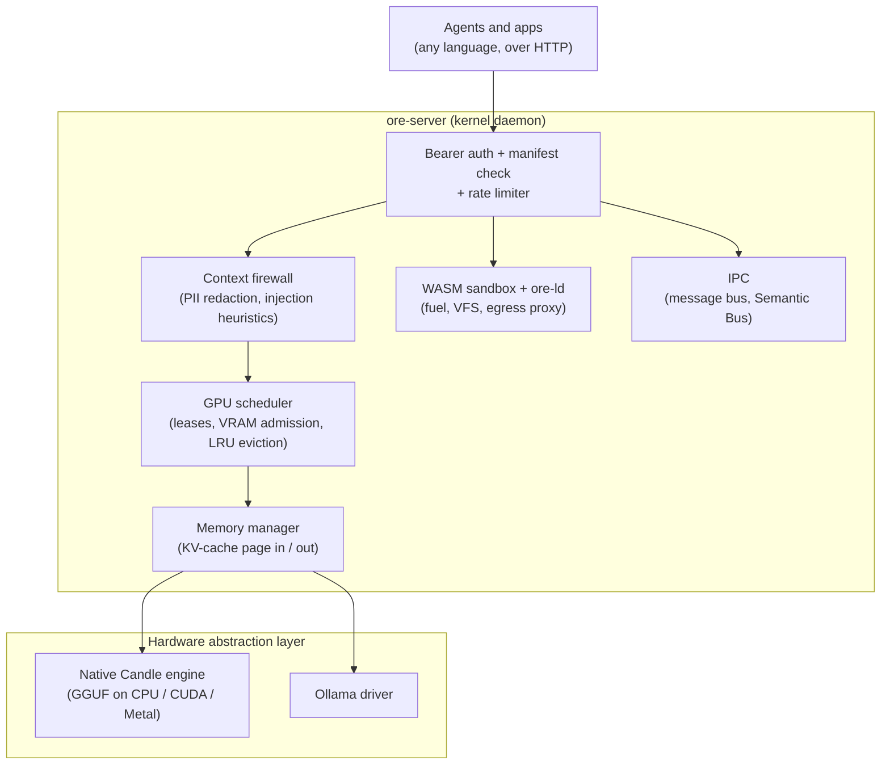

<div align="center">

# Ore

### Open Runtime Environment for local LLM agents

A kernel daemon, written in Rust, that sits between your agents and your hardware.<br>
It schedules the GPU, persists agent memory to disk, sandboxes tools in WebAssembly, and enforces per-agent permissions.

[](https://github.com/Mahavishnu-K/ore-kernel/actions/workflows/ci.yml)
[]()
[](https://github.com/Mahavishnu-K/ore-kernel/releases)
[](https://www.gnu.org/licenses/agpl-3.0)
[]()
[]()
[](https://discord.com/channels/1477053099494342755/1477053558879686737)

[Quick start](#quick-start) · [Architecture](#architecture) · [Documentation](#documentation) · [Roadmap](ROADMAP.md) · [Contributing](#contributing)

</div>

---

## Why Ore?

Local inference engines are built for one client at a time. Run several agents against them and you get three problems:

- **No arbitration.** Agents compete for VRAM, and the usual outcome is an out-of-memory error rather than a queue.
- **No memory.** When an engine switches between agents it discards the KV cache, so every resume re-runs prefill over the whole conversation.
- **No boundaries.** Tool-using agents run with the full privileges of the host process.

Ore is a single daemon that all your agents talk to. Applications never touch the GPU directly. They send requests to Ore, and Ore decides when they run, what they can access, and what they remember.

## Benchmark

On CPU, the cost of switching between agents is prefill. Ore saves each agent's KV cache to disk and restores it instead of recomputing it:

| Resuming a paused agent (Ryzen 7, 16 GB RAM, CPU only) | Time |
|---|---:|
| Recompute prefill over the conversation history | 37.03 s |
| Restore saved KV cache from SSD (Ore) | **2.41 s** |
| **Speedup** | **15.4×** |

Saved caches also survive restarts, so an agent can pick up a long conversation after a reboot without re-processing it.

## Features

| | |
|---|---|
| **GPU scheduler** | Agents acquire RAII leases before inference. Admission control reads real VRAM through NVML and estimates KV-cache size from GGUF geometry. Models that fit are loaded side by side, and the least recently used idle model is evicted when they don't. |
| **KV-cache paging** | An agent's chat history and KV cache are written to `.safetensors` on disk when it goes idle and restored on its next turn. Background compaction caps disk usage. |
| **WebAssembly sandbox** | Tools compiled from Rust, Go, Python, JS, TS, Zig, C, or C++ run in `wasmtime` with a CPU fuel limit, manifest-scoped directory mounts, and no raw sockets. Outbound HTTP goes through a proxy that checks domain, method, and path. Compiled modules are cached as `.cwasm`, for roughly 10 ms start-up. |
| **`ore-ld` dynamic linker** | Load `.wasi.so` plugins (Rust, C, C++, Zig) into a running WebAssembly host with `ore_dlopen` / `ore_dlsym`. The plugin shares the host's linear memory, so large buffers are passed by pointer instead of being serialized. |
| **Agent manifests** | Each agent has a TOML manifest listing the models, files, network domains, tools, and IPC channels it may use, plus a token-per-minute rate limit. Requests are checked against it on every call. |
| **Semantic Bus** | Built-in vector memory shared between agents through named pipes. The embedding model loads on demand and unloads when idle. Pipe access is gated by the manifest. |
| **Native inference** | Pure-Rust GGUF inference via [Candle](https://github.com/huggingface/candle) for Llama, Qwen2, Qwen3, and Qwen3-MoE on CPU, CUDA, or Metal. Ollama is supported as an alternative backend. |
| **Prompt filtering** | Optional regex-based PII redaction and prompt-injection heuristics. These are best-effort filters, not a security boundary. See the [security model](docs/security-model.md). |

> [!WARNING]
> Ore is **alpha** software. APIs, manifest fields, and on-disk formats will change.

## Quick start

**Prerequisites:** [Rust](https://rustup.rs/) 1.93+. To use the Ollama backend, also install [Ollama](https://ollama.com/).

```bash
git clone https://github.com/Mahavishnu-K/ore-kernel.git
cd ore-kernel
cargo install --path ore-cli

ore init                              # choose engine (native or ollama) and embedder
cargo run --release -p ore-server     # start the kernel on http://127.0.0.1:6767
```

Use a release build. Debug builds run native inference 5–10× slower.

In a second terminal:

```bash
ore pull qwen2.5:0.5b                 # download a GGUF model from Hugging Face
ore run qwen2.5:0.5b "Explain what a semaphore is"
ore manifest my_agent                 # create a permission manifest for your agent
```

Your agent then calls the HTTP API with the token the kernel writes to `ore-kernel.token`:

```bash
curl -X POST http://127.0.0.1:6767/run \
     -H "Authorization: Bearer $(cat ore-kernel.token)" \
     -H "Content-Type: application/json" \
     -d '{"app_id": "my_agent", "model": "qwen2.5:0.5b", "prompt": "Hello"}'
```

The [Getting Started guide](docs/getting-started.md) covers compiling sandboxed tools and the Semantic Bus. [`examples/`](examples/) has Python agents for messaging, multi-agent pipelines, and sandboxed tools.

## A manifest

Every agent declares what it can use. It gets only the models, directories, domains, tools, and IPC channels its manifest lists.

```toml
app_id = "researcher"
description = "Reads papers and summarizes them"
version = "1.0.0"

[resources]
allowed_models = ["qwen2.5:0.5b"]
max_tokens_per_minute = 10000
gpu_priority = "normal"
stateful_paging = true                     # page KV cache to disk between turns

[file_system]
allowed_read_paths = ["/home/me/papers"]   # directories only
allowed_write_paths = []

[network]
network_enabled = true
allow_localhost_access = false

[[network.rules]]
domain = "arxiv.org"
allowed_methods = ["GET"]
allowed_paths = ["*"]

[execution]
can_execute_shell = false
can_execute_wasm = true
allowed_tools = ["pdf_extract"]
max_cpu_instructions = 5000000000

[ipc]
allowed_agent_targets = ["writer"]
allowed_semantic_pipes = ["papers"]
```

Every field is documented in the [Manifest Reference](docs/manifest-reference.md).

## Architecture



| Crate | Role |
|---|---|
| [`ore-core`](ore-core/) | Kernel logic: scheduler, memory manager, sandbox, linker, IPC, firewall, inference drivers |
| [`ore-server`](ore-server/) | Axum HTTP daemon, request handlers, execution modes |
| [`ore-cli`](ore-cli/) | The `ore` command: setup, model management, manifests, `mktool` compiler |
| [`ore-common`](ore-common/) | Shared types, protocol, config, and manifest schema |
| [`ore-sys`](ore-sys/) | Rust SDK for writing `ore-ld` hosts and plugins |

## Documentation

| | |
|---|---|
| [Why Ore?](docs/why-ore.md) | The problems Ore solves and the reasoning behind each subsystem |
| [Getting Started](docs/getting-started.md) | Install, first inference, first sandboxed tool, first agent |
| [Architecture](docs/architecture.md) | Request lifecycles and workspace layout |
| [CLI Reference](docs/cli-reference.md) · [API Reference](docs/api-reference.md) | Every command and HTTP route |
| [Manifest Reference](docs/manifest-reference.md) · [Configuration](docs/configuration.md) | Agent permissions and `ore.toml` |
| [Security Model](docs/security-model.md) | Threat model and what each layer does and doesn't protect against |
| [Building Plugins](docs/building-plugins.md) · [Extending Ore](docs/extending-ore.md) | Writing `ore-ld` plugins, drivers, and model architectures |
| [Kernel Internals](docs/kernel-internals/) | Subsystem-by-subsystem deep dives |

## Contributing

Ore is early, so design feedback is as valuable as code. Please open an issue to discuss larger changes before sending a PR. See [CONTRIBUTING.md](CONTRIBUTING.md) and the [Roadmap](ROADMAP.md).

Areas where help is especially welcome:

- **Native architectures:** Mistral, Gemma, Phi, DeepSeek loaders for the Candle engine
- **Drivers:** vLLM, llama.cpp server, or LM Studio backends via the `InferenceDriver` trait
- **Security testing:** adversarial tests for the sandbox, VFS, and egress proxy
- **Benchmarks:** reproducible measurements on hardware we don't have

Chat with us on [Discord](https://discord.com/channels/1477053099494342755/1477053558879686737) in `#dev-core`.

## Acknowledgments

- [Hugging Face Candle](https://github.com/huggingface/candle) powers the native engine. Ore adapts several of its transformer implementations, including community work on Nomic and SwiGLU.
- [Wasmtime](https://github.com/bytecodealliance/wasmtime) powers the sandbox.
- [Ollama](https://github.com/ollama/ollama) serves as the alternative inference backend.

## License

[AGPL-3.0-or-later](LICENSE). Copyright © 2026 Mahavishnu-K.

<div align="center">

Built with 🦀 **Rust** · Designed for the **AI-native era**

*If this project is useful to you, consider giving it a ⭐*

</div>