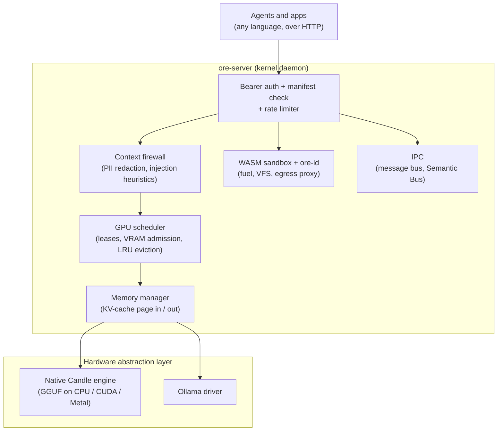

<div align="center">

# Ore

### Open Runtime Environment for local LLM agents

A kernel daemon, written in Rust, that sits between your agents and your hardware.<br>
It schedules the GPU, persists agent memory to disk, sandboxes tools in WebAssembly, and enforces per-agent permissions.

[](https://github.com/Mahavishnu-K/ore-kernel/actions/workflows/ci.yml)
[]()
[](https://github.com/Mahavishnu-K/ore-kernel/releases)
[](https://www.gnu.org/licenses/agpl-3.0)
[]()
[]()
[](https://discord.com/channels/1477053099494342755/1477053558879686737)

[Quick start](#quick-start) · [Nano-services](#nano-services-tools-without-containers) · [Architecture](#architecture) · [Documentation](#documentation) · [Roadmap](ROADMAP.md) · [Contributing](#contributing)

</div>

---

## Why Ore?

Local inference engines are built for one client at a time. Run several agents against them and you get three problems:

- **No arbitration.** Agents compete for VRAM, and the usual outcome is an out-of-memory error rather than a queue.
- **No memory.** When an engine switches between agents it discards the KV cache, so every resume re-runs prefill over the whole conversation.
- **No boundaries.** Tool-using agents run with the full privileges of the host process.

Ore is a single daemon that all your agents talk to. Applications never touch the GPU directly. They send requests to Ore, and Ore decides when they run, what they can access, and what they remember.

## Benchmark

On CPU, the cost of switching between agents is prefill. Ore saves each agent's KV cache to disk and restores it instead of recomputing it:

| Resuming a paused agent (Ryzen 7, 16 GB RAM, CPU only) | Time |
|---|---:|
| Recompute prefill over the conversation history | 37.03 s |
| Restore saved KV cache from SSD (Ore) | **2.41 s** |
| **Speedup** | **15.4×** |

Saved caches also survive restarts, so an agent can pick up a long conversation after a reboot without re-processing it.

## Nano-services: tools without containers

Agents need tools, and tools are usually written in a different language from the agent. Today the choice is between a container (safe, but every call is serialized over a socket) and a native library (fast, but a crash takes the agent down and you rebuild it for every platform).

Ore adds a third option. A **nano-service** is a tool compiled to WebAssembly and run inside the Ore process. It is isolated like a service and called like a library. There are two kinds:

| | Container / microservice | Native FFI | Ore tool (`.wasm`) | Ore plugin (`.wasi.so`) |
|---|---|---|---|---|
| **Isolation** | Process + namespaces | None | WebAssembly sandbox | Sandboxed from the kernel and OS; **shares memory with its host module** |
| **Passing data** | Serialize over a socket | Pointer | stdin / stdout / files | Pointer into shared linear memory |
| **Start-up** | Hundreds of ms to seconds | `dlopen` | ~10 ms (AOT `.cwasm`) | Compile + instantiate on `ore_dlopen` |
| **When it crashes** | Container exits | Host process dies | Trap; kernel keeps running | Trap aborts the host's execution; kernel keeps running |
| **Portability** | Image per architecture | Build per OS and architecture | One `.wasm` runs everywhere | One `.wasi.so` runs everywhere |

### Sandboxed tools (`.wasm`)

`ore mktool` compiles a file or project written in Rust, Go, Python, JavaScript, TypeScript, Zig, C, or C++ into a `.wasm` tool. Any agent, in any language, can then call it through the kernel. Each run gets:

- **A CPU budget.** `wasmtime` fuel metering is enabled for every store. When the manifest's `max_cpu_instructions` budget (default 5×10⁹) runs out, the guest traps instead of hanging the host.
- **Only the files it's allowed.** The guest sees WASI pre-opened directories and nothing else: the manifest's paths, plus a private per-run `/ore_tmp`. Read-only paths are mounted without write rights, so the denial happens at the WASI layer, not in a policy check.
- **No sockets.** The guest has no TCP or UDP access. Outbound HTTP goes through the `ore.fetch` host call to a Layer 7 proxy in the kernel, which checks domain, method, and path against `[[network.rules]]` and writes the response into `/ore_tmp`.
- **Fast start-up.** The first run compiles the module to native code and serializes it as `.cwasm`. Later runs memory-map that file instead of recompiling, cutting a 300–600 ms cold start to about 10 ms. The page cache shares the code pages across concurrent instances.

```bash
ore mktool go_hasher.go        # → ~/.ore/tools/go_hasher.wasm

curl -X POST http://127.0.0.1:6767/execute \
     -H "Authorization: Bearer $(cat ore-kernel.token)" \
     -H "Content-Type: application/json" \
     -d '{"app_id": "my_agent", "tool_name": "go_hasher", "input_data": "hello"}'
```

**Good fit:** tools that take data in, compute, call `ore.fetch` if they need the network, and write data out. **Not a fit:** browsers, GPU training loops, or anything that needs raw sockets or OS threads.

### Memory Fusion with `ore-ld`

Piping through stdin and stdout means serializing. That's fine for most tools, but not when a host module holds a large buffer and a tool needs to transform it in place. `ore-ld` lets a running WebAssembly host load a plugin into its own address space and call it through a function pointer, with no copy.

**What `ore_dlopen("encryptor.wasi.so")` does** ([`linker/syscalls.rs`](ore-core/src/linker/syscalls.rs)):

1. Reads the plugin from `~/.ore/plugins/` and compiles it.
2. Grows the host's linear memory by 16 pages (1 MiB) for the plugin's data segment. The old end of memory becomes the plugin's `__memory_base`.
3. Sets `__table_base` to the current size of the host's function table.
4. Instantiates the plugin with the **host's** `memory` and `__indirect_function_table` as its imports, plus the two base globals. This is the LLVM `-fPIC` WebAssembly dynamic-linking convention.
5. Runs the plugin's `__wasm_call_ctors` and returns a handle (≥ 1, or −1 on error).

**What `ore_dlsym(handle, "xor_cipher")` does:** it grows the host's function table by one slot, stores the plugin's export there, and returns the index. In C, that index *is* a function pointer, so the call compiles to an ordinary `call_indirect`.

```c
// Host (C), trimmed from tests/cross_lang_memory_fusion/c_uses_rust.c
#include <ore.h>

int main() {
    OrePlugin plugin = ore_load("encryptor.wasi.so");
    ORE_BIND(plugin, xor_cipher, void, char*, int, unsigned char);

    char data[] = "C_LOVES_RUST_MEMORY_FUSION";
    xor_cipher(data, sizeof data - 1, 0xAA);   // Rust mutates C's buffer in place
}
```

```rust
// Plugin (Rust), from tests/memory_fusion/encryptor.rs
#![no_std]
use ore_sys::ore_export;

ore_export! {
    fn xor_cipher(data_ptr: *mut u8, len: usize, key: u8) {
        let slice = unsafe { core::slice::from_raw_parts_mut(data_ptr, len) };
        for byte in slice.iter_mut() { *byte ^= key; }
    }
}
```

```bash
ore mktool encryptor.rs --shared    # position-independent plugin → ~/.ore/plugins/encryptor.wasi.so
ore mktool c_uses_rust.c --host     # host built with --export-dynamic --import-table
```

The SDKs hide the ABI details: `ore.h` (`ore_load`, `ORE_BIND`) for C and C++, the `ore-sys` crate (`ore_export!`, `ore_bind!`) for Rust, and `ore.zig` for Zig.

**What this does and doesn't guarantee:**

- ✅ A plugin can't reach the kernel, the host OS, or other agents. It can only touch the host module's linear memory and the imports Ore gives it.
- ✅ An out-of-bounds access or other fault becomes a WebAssembly trap. The execution is aborted and the kernel keeps running.
- ✅ The same `.wasi.so` runs on Linux, macOS, and Windows without rebuilding.
- ⚠️ A plugin is **not** isolated from its host. They share one linear memory, so a buggy plugin can corrupt host data, just as a native shared library could. Only load plugins you trust as much as the host.

**Unloading.** `ore_dlclose(handle)` unloads a plugin immediately. Its table slots are nulled, so calling a stale function pointer traps instead of running freed code. Its 1 MiB slab is zeroed and reused by the next `ore_dlopen`. When a call fails, `ore_dlerror` returns the reason as a string. The SDKs wrap these as `ore_close` / `ore_error` (C), `Drop` / `Plugin::last_error` (Rust), and `close` / `lastError` (Zig).

**Hot-swapping.** A long-running host can `ore_dlopen` a new version of a plugin, re-bind its function pointers, and then `ore_dlclose` the old handle. The host's state is untouched because it lives in the host's memory, not the plugin's.

**Why only Rust, C, C++, and Zig?** These toolchains can emit position-independent WebAssembly that uses an *imported* memory and table. Garbage-collected runtimes (Python, JavaScript, Go) expect to own the whole linear memory, so they can't share one with another module's allocator. They use regular `.wasm` tools instead.

#### is Ore POSIX(`dlfcn.h`) compliant?

ore-ld has its own `dlopen`: `ore_dlopen`, together with `ore_dlsym`, `ore_dlclose`, and `ore_dlerror`. These deliberately don't copy the POSIX `<dlfcn.h>` signatures or semantics. POSIX assumes a process-wide symbol namespace (`RTLD_GLOBAL`), lazy binding, and reference-counted unloading. None of these map cleanly onto WebAssembly, where a module's functions are only reachable through its table. ore-ld keeps the model explicit instead:

- Each plugin gets its own handle.
- Symbols are resolved one at a time through `ore_dlsym`.
- `ore_dlclose` unloads immediately, without reference counting.
- Errors come back through `ore_dlerror`.

The calls are `dlopen`-*style*, so porting existing C plugin code is mostly mechanical.

**Current limits:**

- Each plugin gets a fixed 1 MiB data region.
- `ore_dlclose` doesn't run plugin destructors.
- wasmtime keeps a closed plugin's instance until the agent's execution ends.
- Function pointers a plugin hands to the host directly, rather than through `ore_dlsym`, are not nulled on close.
- Symbols aren't resolved between plugins.
- Plugins are compiled on every `ore_dlopen` rather than AOT-cached.

More: [Polyglot Memory Fusion internals](docs/kernel-internals/polyglot-memory-fusion.md) · [Building plugins](docs/building-plugins.md)

## Features

| Feature | Description |
|---|---|
| **GPU scheduler** | Agents acquire RAII leases before inference. Admission control reads real VRAM through NVML and estimates KV-cache size from GGUF geometry. Models that fit are loaded side by side, and the least recently used idle model is evicted when they don't. |
| **KV-cache paging** | An agent's chat history and KV cache are written to `.safetensors` on disk when it goes idle and restored on its next turn. Background compaction caps disk usage. |
| **WebAssembly sandbox** | Tools in eight languages run in-process under `wasmtime`, with fuel limits, scoped mounts, and an egress proxy. [Details ↓](#sandboxed-tools-wasm) |
| **`ore-ld` dynamic linker** | Plugins are linked into a running WebAssembly host and share its memory, so data is passed by pointer. [Details ↓](#memory-fusion-with-ore-ld) |
| **Agent manifests** | Each agent has a TOML manifest listing the models, files, network domains, tools, and IPC channels it may use, plus a token-per-minute rate limit. Requests are checked against it on every call. |
| **Semantic Bus** | Built-in vector memory shared between agents through named pipes. The embedding model loads on demand and unloads when idle. Pipe access is gated by the manifest. |
| **Native inference** | Pure-Rust GGUF inference via [Candle](https://github.com/huggingface/candle) for Llama, Qwen2, Qwen3, and Qwen3-MoE on CPU, CUDA, or Metal. Ollama is supported as an alternative backend. |
| **Prompt filtering** | Optional regex-based PII redaction and prompt-injection heuristics. These are best-effort filters, not a security boundary. See the [security model](docs/security-model.md). |

> [!IMPORTANT]
> Ore is **alpha** software. APIs, manifest fields, and on-disk formats will change.

## Quick start

**Prerequisites:** [Rust](https://rustup.rs/) 1.93+. To use the Ollama backend, also install [Ollama](https://ollama.com/).

```bash
git clone https://github.com/Mahavishnu-K/ore-kernel.git
cd ore-kernel
cargo install --path ore-cli

ore init                              # choose engine (native or ollama) and embedder
cargo run --release -p ore-server     # start the kernel on http://127.0.0.1:6767
```

Use a release build. Debug builds run native inference 5–10× slower.

In a second terminal:

```bash
ore pull qwen2.5:0.5b                 # download a GGUF model from Hugging Face
ore run qwen2.5:0.5b "Explain what a semaphore is"
ore manifest my_agent                 # create a permission manifest for your agent
```

Your agent then calls the HTTP API with the token the kernel writes to `ore-kernel.token`:

```bash
curl -X POST http://127.0.0.1:6767/run \
     -H "Authorization: Bearer $(cat ore-kernel.token)" \
     -H "Content-Type: application/json" \
     -d '{"app_id": "my_agent", "model": "qwen2.5:0.5b", "prompt": "Hello"}'
```

The [Getting Started guide](docs/getting-started.md) covers compiling sandboxed tools and the Semantic Bus. [`examples/`](examples/) has Python agents for messaging, multi-agent pipelines, and sandboxed tools.

## A manifest

Every agent declares what it can use. It gets only the models, directories, domains, tools, and IPC channels its manifest lists.

```toml
app_id = "researcher"
description = "Reads papers and summarizes them"
version = "1.0.0"

[resources]
allowed_models = ["qwen2.5:0.5b"]
max_tokens_per_minute = 10000
gpu_priority = "normal"
stateful_paging = true                     # page KV cache to disk between turns

[file_system]
allowed_read_paths = ["/home/me/papers"]   # directories only
allowed_write_paths = []

[network]
network_enabled = true
allow_localhost_access = false

[[network.rules]]
domain = "arxiv.org"
allowed_methods = ["GET"]
allowed_paths = ["*"]

[execution]
can_execute_shell = false
can_execute_wasm = true
allowed_tools = ["pdf_extract"]
max_cpu_instructions = 5000000000

[ipc]
allowed_agent_targets = ["writer"]
allowed_semantic_pipes = ["papers"]
```

Every field is documented in the [Manifest Reference](docs/manifest-reference.md).

## Architecture



| Crate | Role |
|---|---|
| [`ore-core`](ore-core/) | Kernel logic: scheduler, memory manager, sandbox, linker, IPC, firewall, inference drivers |
| [`ore-server`](ore-server/) | Axum HTTP daemon, request handlers, execution modes |
| [`ore-cli`](ore-cli/) | The `ore` command: setup, model management, manifests, `mktool` compiler |
| [`ore-common`](ore-common/) | Shared types, protocol, config, and manifest schema |
| [`ore-sys`](ore-sys/) | Rust SDK for writing `ore-ld` hosts and plugins |

## Documentation

| Topics | Description |
|---|---|
| [Why Ore?](docs/why-ore.md) | The problems Ore solves and the reasoning behind each subsystem |
| [Getting Started](docs/getting-started.md) | Install, first inference, first sandboxed tool, first agent |
| [Architecture](docs/architecture.md) | Request lifecycles and workspace layout |
| [CLI Reference](docs/cli-reference.md) · [API Reference](docs/api-reference.md) | Every command and HTTP route |
| [Manifest Reference](docs/manifest-reference.md) · [Configuration](docs/configuration.md) | Agent permissions and `ore.toml` |
| [Security Model](docs/security-model.md) | Threat model and what each layer does and doesn't protect against |
| [Building Plugins](docs/building-plugins.md) · [Extending Ore](docs/extending-ore.md) | Writing `ore-ld` plugins, drivers, and model architectures |
| [Kernel Internals](docs/kernel-internals/) | Subsystem-by-subsystem deep dives |

## Contributing

Ore is early, so design feedback is as valuable as code. Please open an issue to discuss larger changes before sending a PR. See [CONTRIBUTING.md](CONTRIBUTING.md) and the [Roadmap](ROADMAP.md).

Areas where help is especially welcome:

- **Native architectures:** Mistral, Gemma, Phi, DeepSeek loaders for the Candle engine
- **Drivers:** vLLM, llama.cpp server, or LM Studio backends via the `InferenceDriver` trait
- **Security testing:** adversarial tests for the sandbox, VFS, and egress proxy
- **Benchmarks:** reproducible measurements on hardware we don't have

Chat with us on [Discord](https://discord.com/channels/1477053099494342755/1477053558879686737) in `#dev-core`.

## Acknowledgments

- [Hugging Face Candle](https://github.com/huggingface/candle) powers the native engine. Ore adapts several of its transformer implementations, including community work on Nomic and SwiGLU.
- [Wasmtime](https://github.com/bytecodealliance/wasmtime) powers the sandbox.
- [Ollama](https://github.com/ollama/ollama) serves as the alternative inference backend.

## License

[AGPL-3.0-or-later](LICENSE). Copyright © 2026 Mahavishnu-K.

---

<div align="center">

Built with 🦀 **Rust** · Designed for the **AI-native era**

*If this project is useful to you, consider giving it a ⭐*

</div>